 # Mawacon Connect App
 This document describes a concept, architecture, data flows, user interface,
 backend responsibilities and constraints for the **Mawacon Connect App**.
 It is intended as the **main source of guidance for developer**.

 The interactive click dummy for the app is available at:
 https:mawacon-preview.qr-solutions.de/

 The backend for the public API **must be implemented in Laravel (PHP)** and run in a
 dedicated Docker container.

---

## 1. Project Overview

 The Mawacon Connect App is a mobile self-service portal for fiber-internet customers.
 Core goals:
 - Give customers a clear and simple view of their contracts and invoices.
 - Allow them to request changes (e.g. tariff upgrades, TV packages, hardware).
 - Provide a “recommend a friend” (referral) feature.
 - Offer direct support contact (WhatsApp, phone, email, FAQ).

 Important principles:
 - The **mobile app never talks to the intranet directly**.
 - The **Public API** (Laravel) is the only backend exposed to the internet.
 - The **intranet system pushes data** to the Public API on a schedule (mirror).
 - Referral events created in the app flow back to the intranet **as part of the
   mirror response**.
 - There is an **Admin Panel** inside the Laravel backend to configure email routing,
   banners, support contact data, etc.

---

## 2. System Architecture
 
 High-level architecture diagram:

 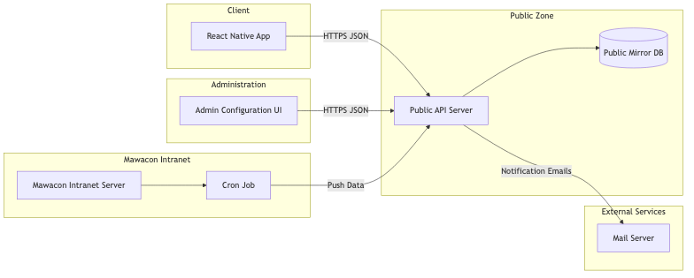

 Components:
 - **React Native Mobile App**
   - Implements all customer-facing screens as shown in the UI screenshots.
   - Communicates exclusively with the Laravel Public API (HTTPS/JSON).

 - **Public API Backend (Laravel, Docker)**
   - Stateless-ish API server.
   - Exposes endpoints for authentication, contracts, invoices, orders, referrals,
     and configuration.
   - Contains the Admin Panel.
   - Stores all mirrored data and app-specific data in a **Public Mirror Database**.

 - **Public Mirror Database (MySQL or compatible)**  
   - Holds customer, contract, invoice and product data as received from the intranet.
   - Holds app-local data such as: users, sessions/tokens, referral events, admin config.

 - **Mawacon Intranet Server**
   - Internal system with original customer, contract and billing data.
   - Has its own database(s) and business logic.
   - Runs a **cron job** that periodically triggers the mirror process.

 - **Mirror Process (Cron Job)**
   - Runs entirely inside the intranet environment.
   - Sends all changed data to the Public API.
   - Receives referral events in the same HTTP response.
   - After processing the response, the Public API flags the sent referral events
   - as “processed”, and the intranet stores/uses them in its own system.

 - **Mail Server**
   - Used by the Public API to send:
     - Registration confirmation emails.
     - Password reset emails.
     - Customer confirmation emails (e.g. “we received your order”).
   - Used to send internal notifications (e.g. new hardware order, tariff change request).

---

## 3. Data Mirror & Referral Sync
 The data mirror is responsible for keeping the Public API database up to date.

 Diagram:

 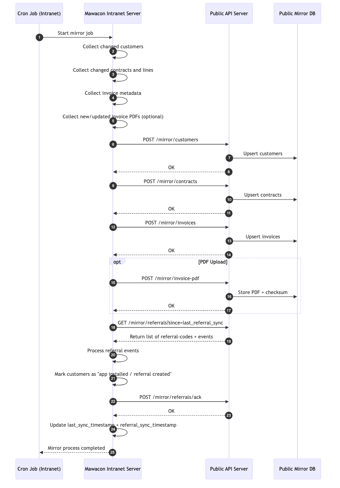

 The process works as follows:

 1. The **intranet cron job** starts the mirror job (e.g. every hour).
 2. The intranet collects all **changed customers, contracts, products and invoices**
    since the last sync.
 3. The intranet sends a mirror request to the Public API,
    e.g. `POST /mirror/sync` with a JSON payload:
    - customers[]
    - contracts[]
    - invoices[]
    - invoiceFiles[] (optional, or separate endpoint)
 4. The Laravel Public API:
    - Validates the mirror token / credentials.
    - Performs *idempotent upserts* (insert or update) into the mirror tables.
 5. After storing the inbound data, the Public API:
    - Gathers all **unprocessed referral events** created by the app.
    - Adds them to the HTTP response body as `referrals[]`.
 6. The intranet processes the HTTP response:
    - Stores referral events in its own DB.
    - Marks customers as “installed app / used referral feature” as needed.
 7. As part of this flow, the Public API updates its referral events:
    - All referral IDs that were included in the response are flagged as
      `processed = true` so they will **not** be sent again.

 Important constraints:
 - The sync **is not real-time**. Data in the app may be up to one sync interval old.
 - The app must be designed to handle slightly stale data gracefully.
 - The Public API never initiates calls to the intranet; the intranet always initiates.

 ---

## 4. Authentication & User Lifecycle

### 4.1 Registration
 Registration is based on customer data already present in the mirror DB.

 Diagram:

 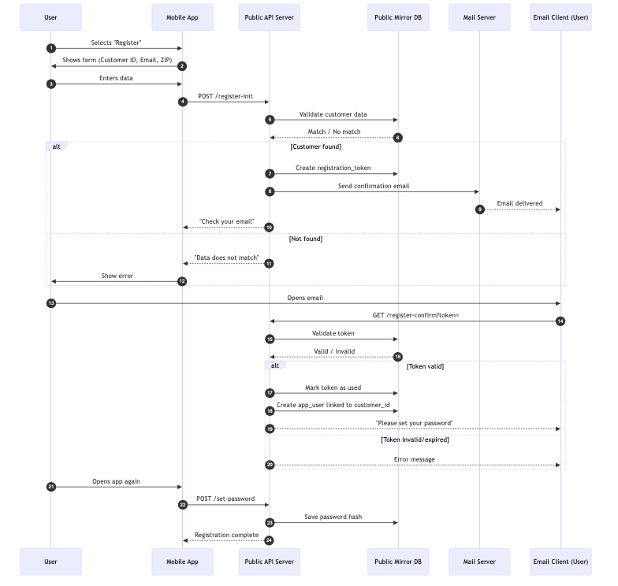

 Summary:
 - User enters: Customer Number, Email, ZIP code (and possibly other fields).
 - Public API looks up a matching customer in the mirror tables.
 - If no match → error message.
 - If match → create a registration token + send email with confirmation link or OTP.
 - User clicks the link / enters OTP:
   - Public API validates token.
   - Creates an app user account linked to that customer.
   - User sets a password.
 - After this, the user can log in with email + password.

 The registration screen is visualised here:

 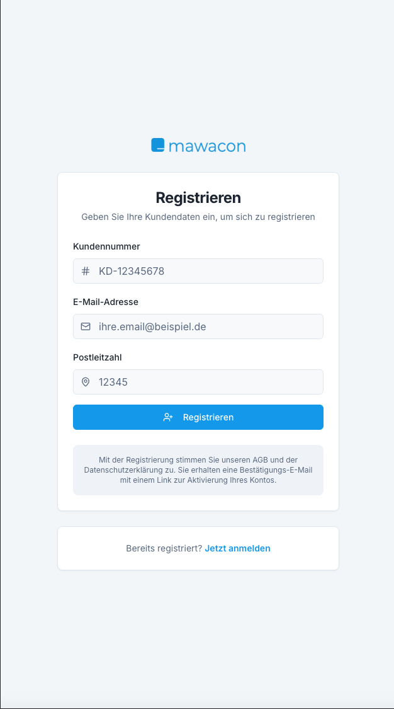

 ### 4.2 Login
 Diagram:

 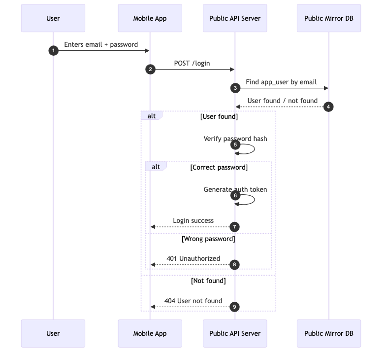

 Summary:
 - User enters email + password.
 - Public API verifies password hash.
 - On success, API issues a token (JWT or Laravel Sanctum).
 - Token is used for all subsequent API calls from the app.
 - Logout simply invalidates the token client-side (and/or server-side if stored).

 ### 4.3 Forgot Password

 The app provides a classic “forgot password” flow.

 Screen:

 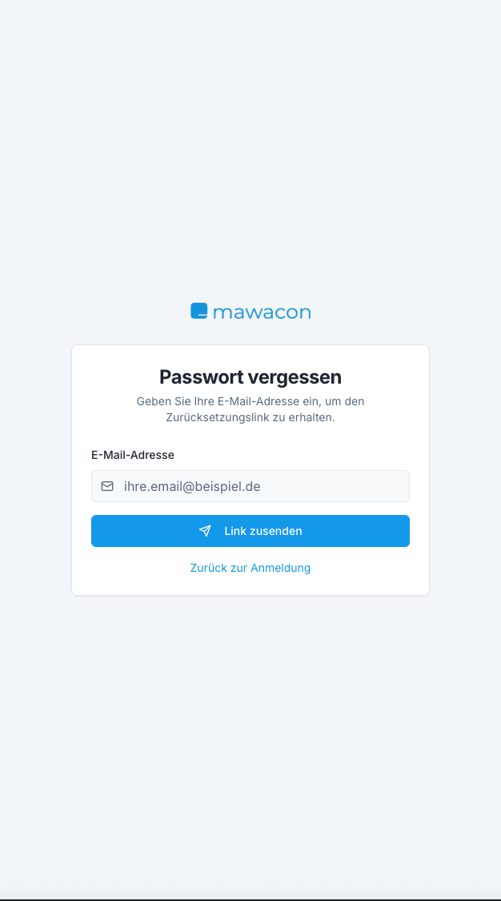

 Flow:
 - User enters email.
 - API sends reset link or code to the email address.
 - User follows link → sets a new password.
 - Token-based login afterwards.

---

## 5. Mobile App UI & Module Breakdown
 The React Native app must follow the layout and behavior of the click dummy and the
 following UI screenshots from `/ui-pictures`.

 Navigation bar (global):

 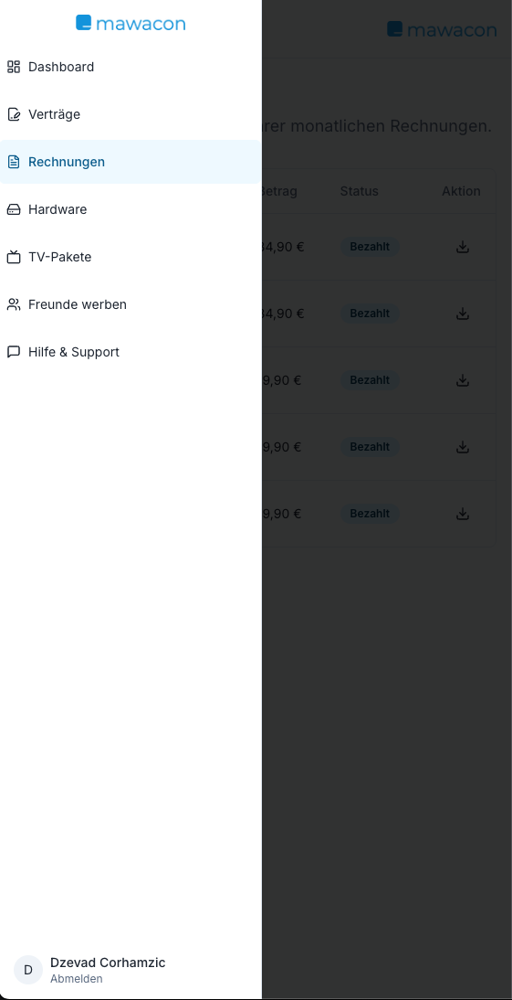

 The navigation bar defines the primary sections of the app:
 - Dashboard
 - Contracts
 - TV Packages
 - Hardware
 - Invoices
 - Referral
 - Support

 
 ### 5.1 Dashboard
 
 Screens:

 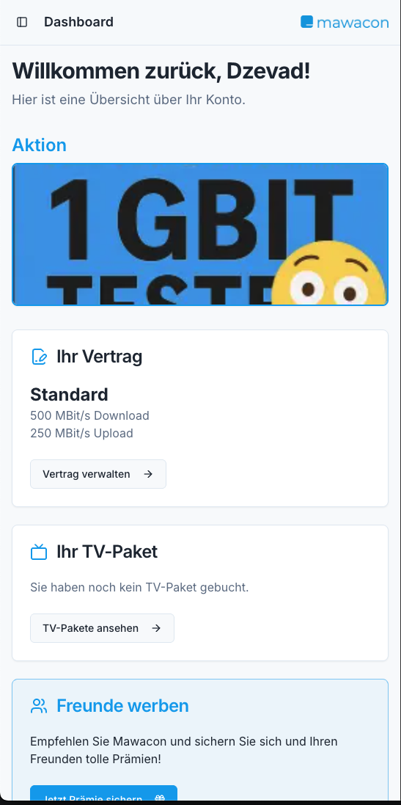
 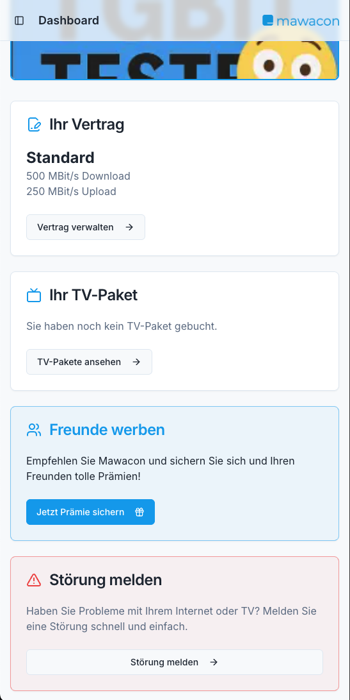

 Behavior:
 - Shows a personal welcome message.
 - Displays key contract information (current tariff, speed, price).
 - Shows a promotional banner (image + text) configured via Admin Panel.
 - Provides quick access tiles to:
   - Contracts
   - TV Packages
   - Hardware
   - Invoices
   - Referral
   - Support

 Data source:
 - All data is read from the Public API (mirror DB).
 - Banner image, text, and visibility are controlled by Admin settings.

 
 ### 5.2 Contracts
 
 Screens:

 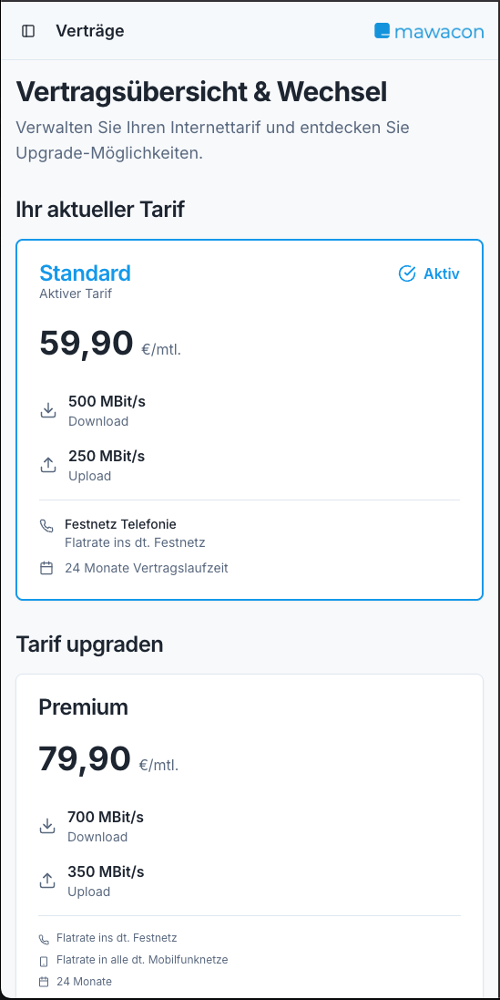
 

 Behavior:
 - Shows a list of contracts (usually one main internet contract).
 - Each contract shows:
   - Tariff name.
   - Speed (e.g. 500 Mbit/s).
   - Price.
   - Status.
 - Provides an option to request a **tariff upgrade**.

 Tariff upgrade flow:
 - User selects a new tariff.
 - App sends a request to Public API.
 - Public API sends:
   - An email to configured staff address.
   - A confirmation email to the customer (“we received your request”).
 - No automatic provisioning; actual changes are done manually by staff.

 
 ### 5.3 TV Packages
 
 Screens:

 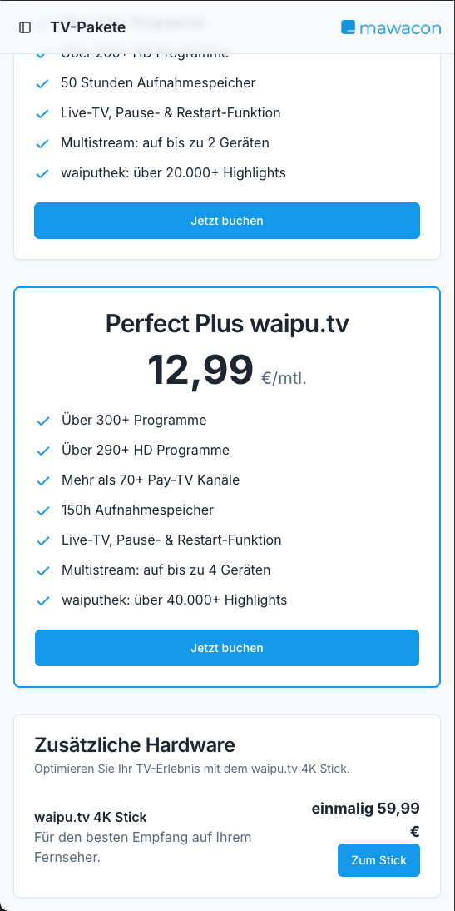
 

 Behavior:
 - Shows available TV packages with:
   - Name
   - Description
   - List of included channels or features
   - Monthly price
 - Allows user to book a TV package or cancel existing one.

 Booking flow:
 - App sends booking request to Public API.
 - Public API sends:
   - Email to staff.
   - Confirmation email to customer.
 - No automatic activation; handled manually.

 
 ### 5.4 Hardware
 
 Screens:

 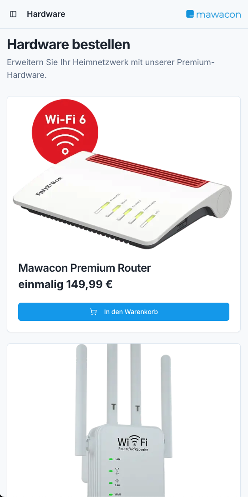
 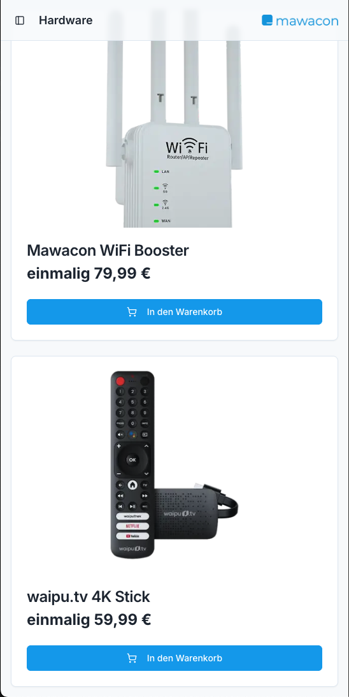

 Behavior:
 - Displays hardware catalog:
   - Routers
   - WiFi boosters
   - TV sticks
   - etc.
 - Each item shows:
   - Name
   - Photo
   - Price (one-time or monthly)
   - Short description
 - User can place an order for one or more items
   (design indicates single item order per request, not a large shopping cart).

 Order flow:
 - App sends hardware order request to Public API.
 - Public API logs the order and sends:
   - Email to staff with customer + hardware details.
   - Confirmation email to customer.
 - Hardware shipping and billing handled manually by staff.

 
 ### 5.5 Invoices
 
 Screen:

 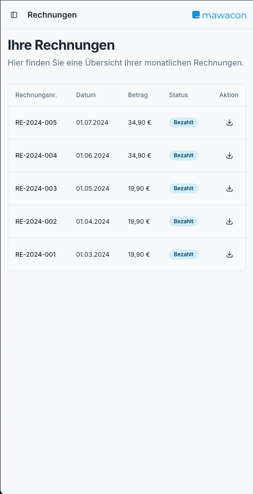

 Behavior:
 - Shows a list of invoices with:
   - Invoice number
   - Date
   - Amount
   - Status (paid / open)
 - Provides a button to download the invoice as PDF.

 PDF download logic:
 - App requests a download URL from the Public API.
 - Public API generates a **short-lived, signed URL** to the PDF resource.
 - App opens this URL in the system viewer/browser.
 - PDFs are stored either in the Public environment or copied from intranet
   during mirror sync and must not be directly publicly browsable.

 
 ### 5.6 Referral (Friends Invite)
 
 Screen:

 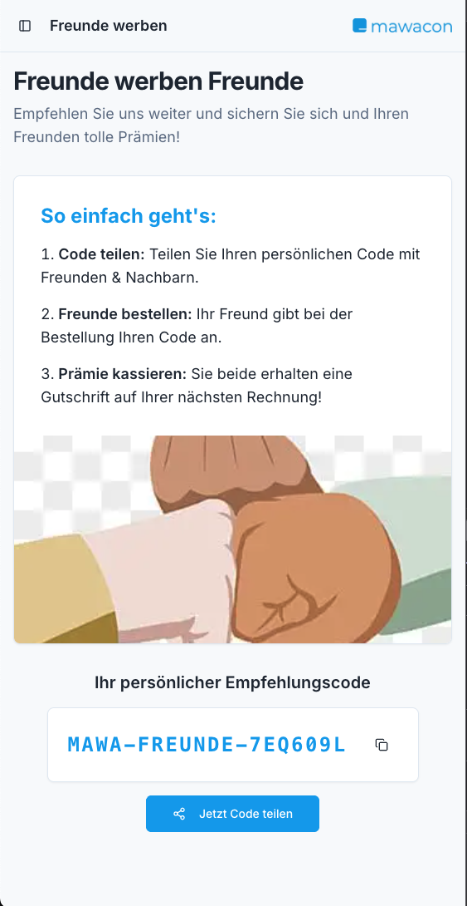

 Behavior:
 - Displays a personal referral code for the logged-in customer.
 - Provides share buttons for:
   - WhatsApp
   - Email
   - other share targets.
 - Shows a list of referred friends, based on data coming from the intranet
   (once processed there).

 Technical behavior:
 - When the user first opens the referral screen, the Public API ensures
   a referral code exists for that customer; if not, it generates one
   and stores it as a **referral event**.
 - Each time the referral feature is actively used (e.g. share tap), the Public API
   may create additional referral usage events.
 - These events are then delivered to the intranet in the **mirror response**.
 - Once the response with those events has been sent, the Public API marks them
   as `processed = true` to avoid double reporting.

 Important limitation:
 - The Public API does **not** calculate or manage rewards or vouchers.
 - All rewards, bonuses, or gifts are handled manually in the intranet.

 
 ### 5.7 Support
 
 Screens:

 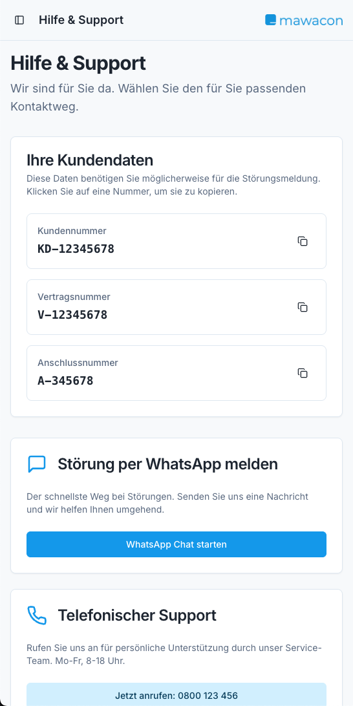
 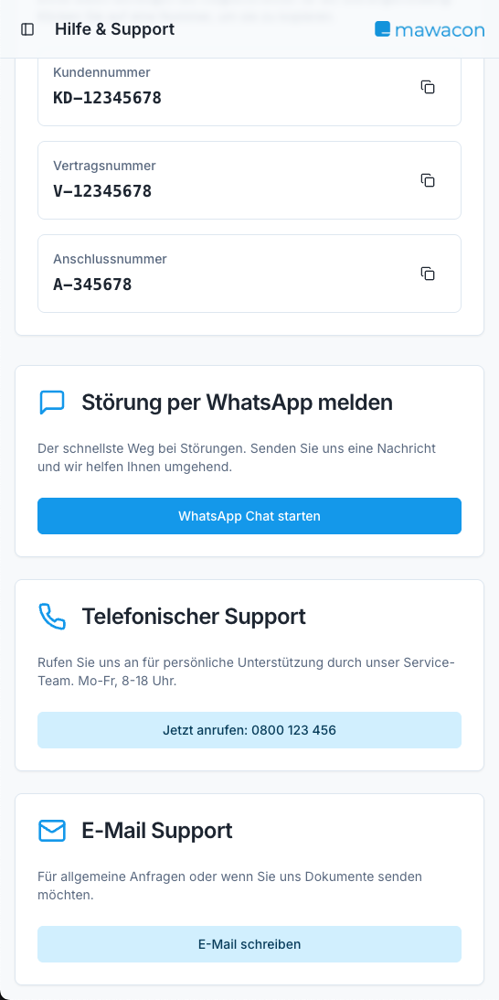

 Behavior:
 - Shows:
   - WhatsApp support entry (deep link to WhatsApp chat).
   - Support email entry (mailto link).
   - Support phone number (tap-to-call).
   - FAQ section with static or semi-static entries.

 All contact details are configurable via the Admin Panel (see below).

---

## 6. Admin Panel (Laravel Backend)
 Screens:

 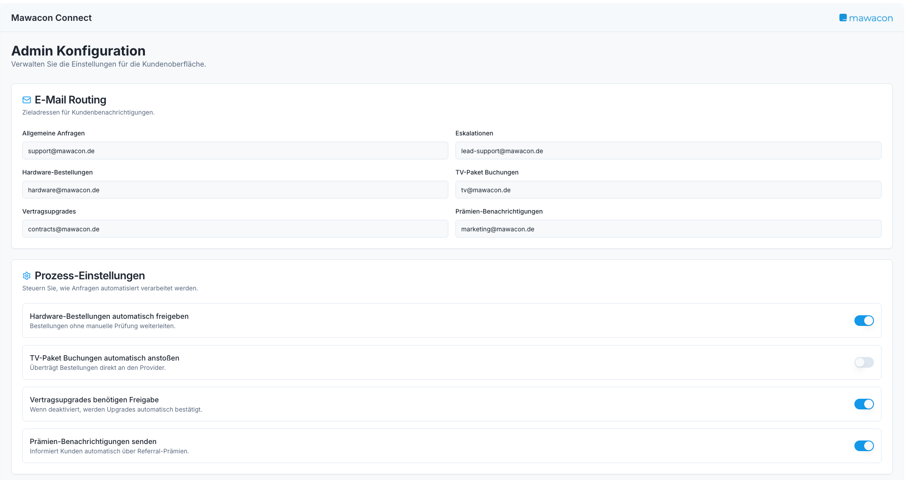
 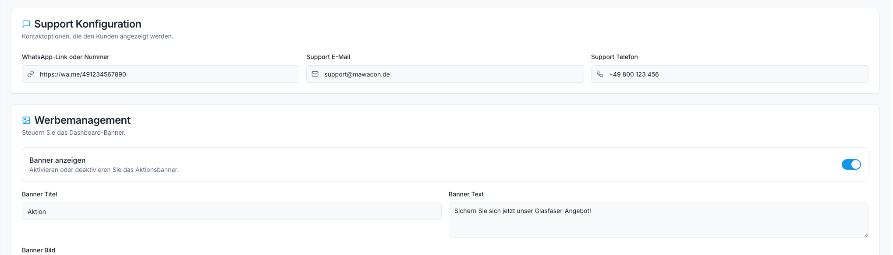
 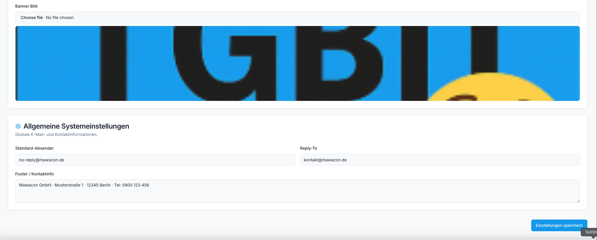

 The Admin Panel is a web UI built on top of the Laravel backend.
 It is intended for internal staff and not accessible to end customers.

 Responsibilities:
 - Configure email addresses for:
   - hardware orders
   - TV package bookings
   - tariff upgrade requests
   - referral notifications
 - Configure dashboard banner:
   - Upload / change banner image
   - Toggle banner visibility
   - Set banner text/title/subtitle as needed
 - Configure support data:
   - WhatsApp link/number
   - Support email address
   - Support phone number
 - Configure generic app settings:
   - Company contact info
   - Default “from” email for outbound messages
   - Feature toggles if needed (e.g. disable referral).

 Implementation recommendation:
 - Use Laravel Blade (simplest) or Inertia.js/Vue if preferred.
 - Admin routes should be behind authentication + basic authorization.

---

## 7. Technical Responsibilities of the Laravel Public API
 The external developer must implement at least the following:

 1. **Authentication & Users**
    - User registration (based on mirror customer data).
    - Password-based login.
    - Forgot-password flow.
    - Token-based session handling.

 2. **Mirror Endpoints**
    - Single main endpoint: e.g. `POST /mirror/sync` that receives:
      - customers[]
      - contracts[]
      - invoices[]
      - invoiceFiles[] or a separate upload endpoint.
    - Upsert logic (idempotent).
    - In the same HTTP response, return:
      - referrals[] : unprocessed referral events.
    - After sending them, mark them as processed.

 3. **Domain Endpoints for App**
    - `/contracts` : list + detail for logged-in customer.
    - `/contracts/upgrade` : create upgrade request.
    - `/tv-packages` : list TV packages; show which are active.
    - `/tv-packages/order` : create booking request.
    - `/hardware` : list hardware items.
    - `/hardware/order` : create hardware order.
    - `/invoices` : list invoices.
    - `/invoices/{id}/download-url` : return secure PDF URL.
    - `/referral` : get or create referral code, list referrals.
    - `/support/config` : get support contact settings.
    - `/config/dashboard` : get banner configuration.

 4. **Admin Panel**
    - Authentication/authorization for admins.
    - CRUD for config items (emails, banner, support info).

 5. **Security**
    - HTTPS-only expectation (handled at proxy level, but assume secure).
    - Input validation for all endpoints.
    - Proper escaping in Admin UI to avoid XSS.
    - No direct network access to intranet hosts.

 6. **File Handling (PDF)**
    - Store invoice PDFs in a non-public directory or storage bucket.
    - Provide time-limited signed URLs to download PDFs.
    - Optional: store checksum or metadata in DB.

---

## 8. Constraints & Non-Goals
 The following are **explicitly out of scope** for this project:
 - Real-time synchronization (sync is periodic, e.g. hourly).
 - Automatic provisioning of tariffs, hardware, or TV packages.
 - Any reward calculation or voucher engine for referrals.
 - A web portal for customers (only mobile app is in scope).
 - Push notifications (FCM/APNS).
 - Direct integration with external partner systems.
 - Any logic that requires direct database access to the intranet.

---

## 9. Implementation Stack & Environment
 - Backend: Laravel (latest stable), PHP 8.x
 - Frontend: React Native (separate project, but strongly linked to this API)
 - Database: MySQL or MariaDB
 - Deployment: Docker / Docker Compose
 - Emails: Laravel mailer (SMTP config provided separately)
 - Auth: Laravel Sanctum or JWT package

 Recommended high-level folder structure for the backend (non-binding):
 - app/Http/Controllers/Api/... (public endpoints)
 - app/Http/Controllers/Admin/... (admin UI)
 - app/Models/... (User, CustomerMirror, ContractMirror, InvoiceMirror, ReferralEvent, ConfigSetting, etc.)
 - database/migrations/... (for mirror tables and app tables)
 - routes/api.php (mobile + mirror endpoints)
 - routes/web.php (admin panel)

---

## 10. Summary
 - The Mawacon Connect App is a React Native mobile client powered by a Laravel
   Public API that receives mirrored data from an intranet system.
 - The Public API does **not** communicate back to the intranet except via the
   shared mirror HTTP request/response initiated by the intranet.
 - All core user journeys (dashboard, contracts, TV packages, hardware, invoices,
   referrals, support) are defined through the UI screenshots and click dummy.
 - The Admin Panel allows Mawacon staff to adjust settings without redeploying.
 - Referral events are created in the Public API when customers use the app,
   then transmitted to the intranet during the next mirror cycle and marked as processed.

 This document, together with the diagrams in `/diagrams` and the UI previews in
 `/ui-pictures`, should give the external developer everything needed to implement
 the Laravel backend and support the React Native app.

 End of `mawacon-connect-app.md`.
